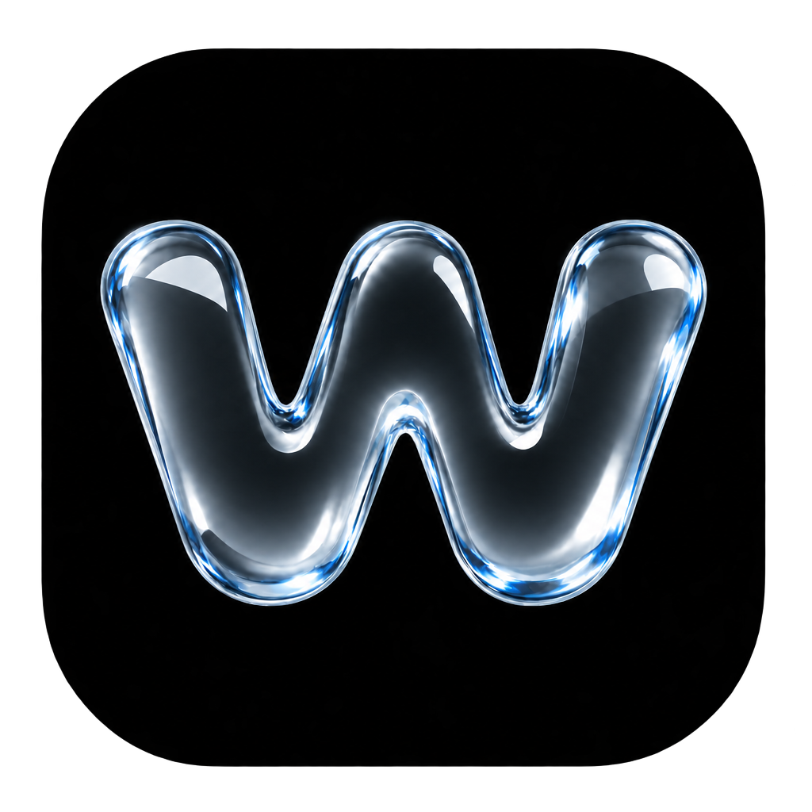
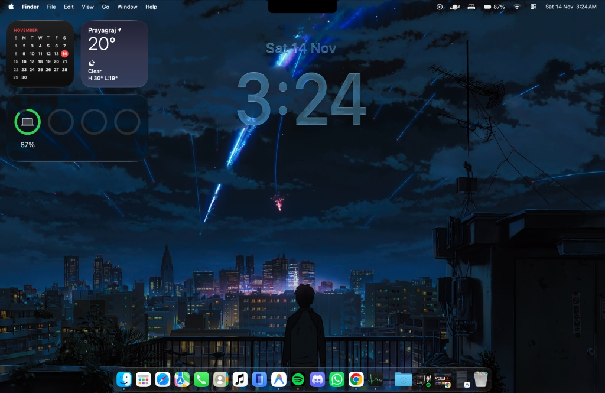
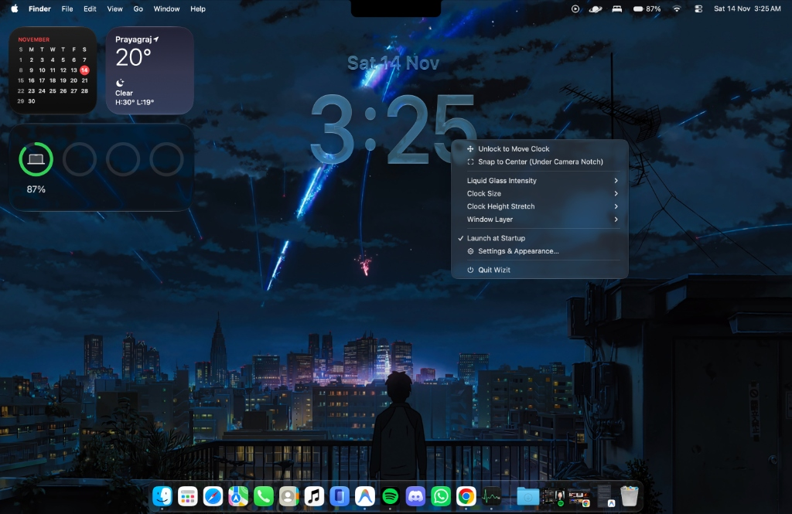
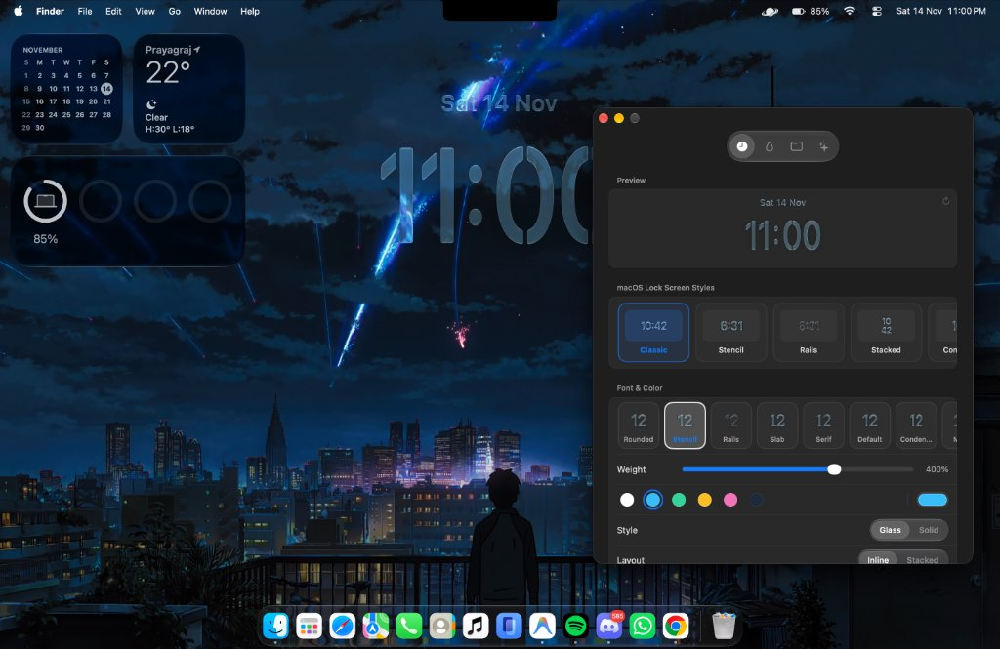

# Wizit

<p align="center">
  
</p>

<p align="center">
  <strong>Native macOS Liquid Glass Lock Screen Clock for Your Desktop</strong><br />
  A hyper-realistic, border-free desktop clock widget crafted in Swift and SwiftUI for macOS Sonoma, Sequoia, and Apple Silicon.
</p>

<p align="center">
  
</p>

---

## Overview

**Wizit** brings the iconic, photorealistic **Apple Lock Screen Clock** directly to your active macOS desktop. Unlike traditional widgets or flat overlays, Wizit renders **native optical liquid glass**: the clock digits act as physical glass prisms that refract, magnify, and bend your desktop wallpaper beneath them with dynamic caustics, specular rim glints, and soft ambient drop shadows.

Wizit is designed to be completely unobtrusive: it sits quietly at the desktop layer behind your active applications, creates zero menu bar clutter, and features a clean, native macOS interface.

---

## Key Features

### 💧 Native Liquid Glass Optics
- **True Optical Refraction**: Characters refract and distort the desktop wallpaper underneath with physical caustics and lensing.
- **Specular Rim Glints**: Fine micro-hairline bevel highlights that catch light like polished crystal.
- **Surface Sheen & Luster**: Internal ambient luminosity and curvature sheen simulating refractive index ($n \approx 1.52$).
- **Custom Color Picker & Tints**: Full native macOS ColorPicker to select any custom liquid glass tint color, plus curated presets (Clear, Ice Blue, Emerald, Sunset, Rose, Obsidian).
- **3D Floating Ambient Depth**: Multi-layer diffused drop shadow creating a physical sensation of floating glass above your wallpaper.
- **Curated Glass Presets**: Instant access to *Apple Lock Screen Frost*, *Stencil Glass*, *Pure Crystal*, *Deep Obsidian*, and more.

### ⏱️ Clock & Typography
- **macOS Lock Screen Clock Styles**: Stencil, Prismatic Rails, Sonoma Classic, Big Stacked Poster, Athletic Condensed, Editorial Roman, Modern Slab, Retro Digital, and Minimalist Hairline.
- **Native Lock Screen Fonts**: Extracted directly from Apple's numeric typefaces (`.SFStencilNumeric`, `.SFRailNumeric`, `.ADTSlabNumeric`, `.SFRoundedNumeric`, etc.).
- **Independent Digit Transitions**: Each time digit animates independently on change (e.g., shifting from `1:34` to `1:35` animates only the `5`, while `1:39` to `1:40` animates both digits) with customizable styles (Drop, Pop, Slide, Flip) and motion blur.
- **12-Hour & 24-Hour Modes**:
  - In 24-hour mode, hours display without leading zeros (`1:34` instead of `01:34`).
  - In 12-hour mode, includes a balanced, non-intrusive AM/PM indicator.
- **Clean Date Header**: Minimalist, lock-screen-matched date header (`Sat 14 Nov`) in bold liquid glass.
- **Optional Seconds Ticker**: Smooth seconds display when desired.

### 🎯 Interactive Move & Resize Handles
- **Snap Dead Center**: One-click centering aligned beneath the MacBook camera notch.
- **Apple Lock Screen Modular Frame**: Clean, translucent modular glass frames for date and time.
- **Corner Resize Arc Handle**: A sleek quarter-circle corner arc at the bottom-right of the frame:
  - Anchored top-left scaling that expands directly towards your cursor without pushing into the camera notch.
  - Drag horizontally (left/right) to scale overall size smoothly.
  - Drag vertically (down/up) to stretch or condense clock height.
- **Screen Boundary Protection**: Invisible 4-sided screen boundary prevents the widget from ever being dragged off-screen or lost outside the display.
- **Native Frosted Done Button**: Clean `Done` capsule nestled safely inside the widget.
- **Trackpad Pinch-to-Zoom**: Fluid two-finger pinch gesture anywhere on the clock to dynamically resize.

### 🪟 Desktop Layering & System Integration
- **Zero Status Bar Clutter**: Runs purely as a desktop clock with no status bar icon or menu bar distraction.
- **Desktop Level Pinning**: Sits at `normalWindow - 1`, remaining stationary behind all open applications across Mission Control and Spaces without blocking clicks to other apps.
- **Launch at Startup**: Integrated with native macOS `SMAppService.mainApp` (macOS 13+ System Settings > General > Login Items).
- **Position & Size Persistence**: Remembers your exact desktop position, scale, and height ratio across restarts.
- **Minimalist Native Context Menu**: Right-click context menu built exclusively with Apple SF Symbols and zero emojis.
- **Retina Application Icon**: Packaged with a native multi-resolution macOS `AppIcon.icns`.

---

## 🎮 Interface & Controls

<p align="center">
  
  
</p>

| Action | How to Trigger |
| :--- | :--- |
| **Open Settings** | Right-click the clock $\to$ Select `Settings & Appearance…` |
| **Move Clock** | Right-click $\to$ Select `Unlock to Move Clock`, then drag the dotted frame |
| **Resize & Stretch** | In Move mode, drag the **single corner notch** (`III`) horizontally for size, vertically for height |
| **Pinch to Resize** | Use a two-finger pinch gesture on your trackpad over the clock |
| **Pick Custom Color** | Settings $\to$ `Liquid Glass` $\to$ Click the `Custom` color picker under Glass Tint Color |
| **Center Clock** | Right-click $\to$ Select `Snap to Center (Under Camera Notch)` |
| **Toggle 24-Hour** | Settings $\to$ `Clock & Font` $\to$ Toggle `24-Hour Time Format` |
| **Launch at Login** | Right-click $\to$ Toggle `Launch at Startup` (or in Settings) |
| **Lock Clock** | Click `Done` or right-click $\to$ Select `Lock Clock Position` |

---

## 🛠️ Architecture & Tech Stack

- **Language**: Swift 6 (with Strict Concurrency Checking)
- **Frameworks**: SwiftUI, AppKit, Combine, ServiceManagement (`SMAppService`)
- **Rendering**: Multi-pass CoreGraphics & Metal shaders for refractive caustics, specular bevels, and ambient occlusion
- **Bundle**: Standalone sandboxed macOS application bundle (`Wizit.app`)

```
wizit/
├── Package.swift
├── Sources/Wizit/
│   ├── App/                     # Entry point & App lifecycle
│   ├── Models/
│   │   ├── AppSettings.swift    # Persistent configuration & reactivity
│   │   ├── LaunchAtLoginManager.swift # SMAppService startup manager
│   │   └── TimeManager.swift    # Timer publisher & independent digit logic
│   ├── Views/
│   │   ├── ClockWidgetView.swift# Clock layout, digit animation & edit handles
│   │   ├── LiquidGlassText.swift# Multi-pass liquid glass shader & refraction
│   │   └── SettingsView.swift   # Glass optics, typography & positioning UI
│   └── Windows/
│       └── DesktopWindowManager.swift # NSWindow desktop layering & AppKit hosting
├── assets/                      # Application screenshots & media
└── scripts/
    └── build_app.sh             # Release build & .app bundle packaging
```

---

## 🚀 Building & Running

### Requirements
- **macOS 14.0 (Sonoma)** or later
- **Xcode 15+** or **Swift 6.0+** toolchain
- Apple Silicon (M1/M2/M3/M4) or Intel Mac

### 1. Build the Standalone `.app` Bundle
Run the build script to compile in release mode and package `Wizit.app`:

```bash
./scripts/build_app.sh
```

### 2. Launch Wizit
```bash
open Wizit.app
```

Or run directly from source via Swift Package Manager:

```bash
swift run -c release
```

---

## ⚙️ Customization

Through the **Settings Window** (Right-click clock $\to$ `Settings & Appearance…`), you can customize:
- **Refraction Lensing**: Adjust the optical background magnification and distortion level.
- **Specular Rim Glint**: Fine-tune the brightness of the incident light edge reflections.
- **Surface Sheen**: Control the ambient light curvature and internal crystal luster.
- **Ambient Shadow**: Adjust the floating depth above your desktop wallpaper.
- **Custom Color Cast**: Pick any color using the system ColorPicker or select one of the curated presets.
- **Font Typography & Weight**: Switch between `.SFRoundedNumeric`, SF Pro Display, SF Pro Mono, and New York Serif, from Ultra Light to Heavy.
- **Height Aspect Ratio**: From condensed 85% to ultra-tall 155% lock screen proportions.

---

## 📄 License

Copyright © 2026. All rights reserved.
Distributed under the MIT License.
